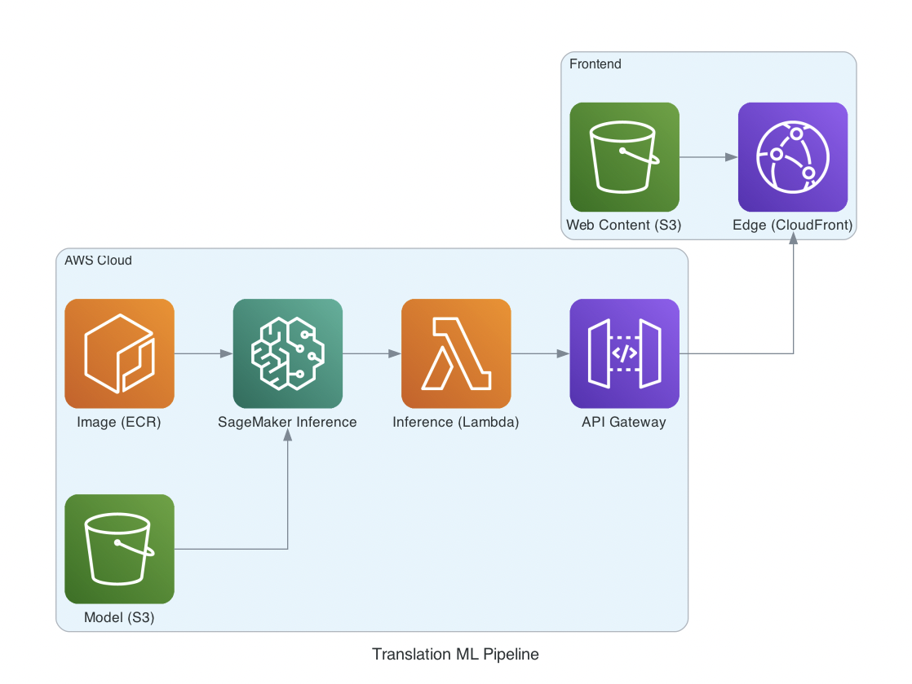

# Transformer from Scratch

A project to train a Transformer model for Korean-to-English translation and deploy it on an AWS Serverless architecture to serve as an API.

Link: [https://d1bzovg3yqbyjp.cloudfront.net/](https://d1bzovg3yqbyjp.cloudfront.net/)

## Tech Stack

| Category | Stack |
| --- | --- |
| Neural NLP | PyTorch, Transformer, RoPE, GQA, SwiGLU, KV Cache, Beam Search |
| Cloud | S3, ECR, SageMaker Serverless, Lambda, API Gateway, CloudFront |
| Serving | FastAPI, Docker |

## Architecture


## Key Achievements

### 1. Model Architecture & Inference Algorithm Enhancement

* **Zero-Base Implementation & Optimization**: Designed and built a lightweight 0.08B parameter Transformer model from scratch, optimized specifically for Korean-to-English translation.
* **Modern Architecture Integration**: Adopted RoPE (Rotary Positional Embedding), GQA (Grouped Query Attention), and SwiGLU to improve structural model performance.
* **Maximizing Inference Efficiency**: Implemented KV Cache to accelerate token generation speed and applied Beam Search to secure consistent translation quality over simple Greedy decoding.
* **Inference Lightweighting**: Converted the base `FP32` model to `BF16`, reducing both size and latency by half.

### 2. AWS-Based Cost-Effective Serverless Pipeline

* **Serverless Architecture Design**: Utilized SageMaker Serverless Inference to eliminate always-on infrastructure costs, creating a pay-per-request deployment environment (dramatically reducing costs compared to always-on setups). Provisioned concurrency was configured to mitigate cold start latency caused by loading the PyTorch framework.
* **Full-Stack Infrastructure Integration**: Built an end-to-end pipeline connecting `S3` (Model) + `ECR` (Container) + `SageMaker` (Inference) + `Lambda` + `API Gateway`.
* **Container-Based Deployment**: Containerized the inference environment using Docker and ECR to ensure environment consistency and automate the deployment process.

# Model Training

## Objectives

* Train a lightweight Transformer (0.08B) model capable of translating various Korean texts into English, ranging from daily casual conversations to news, legal, and domain-specific sentences.
* Go beyond basic functionality by integrating inference quality and efficiency optimization components like Beam Search and KV Cache.

## Dataset

Constructed a parallel corpus by combining the following datasets:

1. [Korean-English Translation (Parallel) Corpus](https://aihub.or.kr/aihubdata/data/view.do?currMenu=115&topMenu=100&aihubDataSe=data&dataSetSn=126) (AI Hub)
2. [Colloquial and Spoken Korean-English Translation Parallel Corpus](https://aihub.or.kr/aihubdata/data/view.do?dataSetSn=71265) (AI Hub)
3. [Domain-Specific Korean-English Corpus](https://aihub.or.kr/aihubdata/data/view.do?pageIndex=9&currMenu=115&topMenu=100&srchOptnCnd=OPTNCND001&searchKeyword=&srchDetailCnd=DETAILCND001&srchOrder=ORDER001&srchPagePer=20&srchDataRealmCode=REALM002&aihubDataSe=data&dataSetSn=111) (AI Hub)

## Training Process Summary

### Early Version (25.03):

* Functional based on prior DE->EN experiment experience, but had clear limitations regarding attention scaling, SacreBLEU evaluation, and inference optimization.

### Improved Version (26.03):

* Switched tokenizer from `FacebookAI/xlm-roberta-base` to `klue/roberta-base`.
* Enhanced special token mapping (`bos/eos/pad`) for the Korean tokenizer.
* Resolved training stagnation by tuning the learning rate schedule, head dimensions, and stack depth.
* Incorporated structural enhancements including Beam Search, KV Cache, GQA, SwiGLU, and RoPE.

Detailed logs are available at [model_training/update_log.md](https://www.google.com/search?q=model_training/update_log.md).

## Quality

* Validation Loss: Dropped to 0.69 after 1 epoch; training was stopped as no further improvement was observed.
* Validation BLEU Range: Approximately `0.28 ~ 0.68` (single-sentence score) -> solid performance.
* ***What is BLEU Score?*** A metric used to evaluate translation quality. Generally, a score above 0.3 indicates meaningful translation quality, while a score above 0.45 is considered professional translator-level.


* Maintained relatively stable sentence structures even on domain-specific samples.
* Performance slightly degrades on longer sentences or homonyms, but overall key semantic meaning is successfully conveyed.

Sample analysis is documented in [model_training/sample_generation.md](https://www.google.com/search?q=model_training/sample_generation.md).

# Deployment on AWS

## Architecture

### Current Deployment Path:

* Model files uploaded to S3 in compressed `BF16` format.
* S3 model artifacts mounted to SageMaker runtime path (`/opt/ml/model`).
* Inference server container image pushed to ECR.
* SageMaker Serverless Endpoint executes actual inference requests.
* Lambda functions as a middleware receiving external calls and routing them to the Endpoint.
* API Gateway serves as the public entry point triggering Lambda.

## Deployment Strategy Rationale

* Direct EC2 Deployment: High ongoing instance costs ($100+/month).
* Standalone Lambda Execution: OOM issues due to memory limitations.
* Final Choice: SageMaker Serverless Inference (Optimal cost/performance balance).

## Server Interface

* Server implemented with FastAPI in `app.py`.
* `GET /ping` : Health check
* `POST /invocations` : Inference invocation

Request Example:

```json
{
	"text": "양도계약의 합의파기에 의한 소유권이전등기의 말소 시 취득처리에 대한 취득세 부과여부에 대한 판결"
}

```

Response Example:

```json
{
	"translation": "Whether or not the acquisition tax is imposed on the cancellation of the ownership transfer registration based on the settlement of the transfer contract."
}

```

Quick test script (public endpoint via API Gateway):

```bash
curl -X POST "https://72nt91ko27.execute-api.ap-northeast-2.amazonaws.com/TranslatorStage" \
     -H "Content-Type: application/json" \
     -d '{"text": "양도계약의 합의파기에 의한 소유권이전등기의 말소 시 취득처리에 대한 취득세 부과여부에 대한 판결"}'

```

## Image Build & Push

Inside the `aws_deployment` folder:

```bash
./build_upload_container.sh

```

### Key Files

* [aws_deployment/README.md](https://www.google.com/search?q=aws_deployment/README.md)
* [aws_deployment/build_upload_container.sh](https://www.google.com/search?q=aws_deployment/build_upload_container.sh)
* [aws_deployment/Dockerfile](https://www.google.com/search?q=aws_deployment/Dockerfile)
* [aws_deployment/src/app.py](https://www.google.com/search?q=aws_deployment/src/app.py)
* [aws_deployment/src/sample_request.py](https://www.google.com/search?q=aws_deployment/src/sample_request.py)

# Frontend

* Web interface built with simple HTML/CSS/JS.
* Takes user input, calls the API, and displays the translated result on screen.
* `index.html` handles API endpoint URL mapping and request/response processing logic.
* Globally accessible via `CloudFront` distribution.
* [https://d1bzovg3yqbyjp.cloudfront.net/](https://d1bzovg3yqbyjp.cloudfront.net/)

# Limitations and Future Work

### Model Performance

The 0.08B model struggles to produce flawless translations for complex long sentences, homonyms, or specialized technical jargon. Expanding the dataset, stacking more layers, and increasing hidden dimensions can enable scaling up to 1B+ parameter models in the future. Modern transformer models typically achieve high performance by stacking 20–30+ layers with hidden dimensions around 4096.

### Deployment Optimization

While currently deployed on SageMaker Serverless Inference, there is room for improvement regarding cold start latency and high-volume traffic scalability. The current 0.08B model takes a few seconds to respond. As the model grows larger, serving via GPU instances on SageMaker using vLLM/SGLang, or deploying to an EKS (Kubernetes Pod) / ELB setup for true business-scale production, would be ideal.

### API Feature Expansion

Currently limited to simple translation, but can be extended to various NLP tasks such as text summarization and question answering. Applying Next Token Prediction training followed by SFT/RLHF could potentially scale it into a full interactive conversational model similar to GPT-4.
